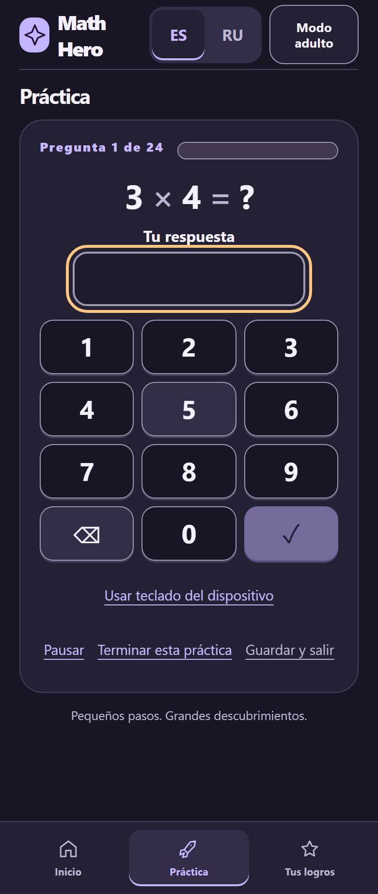
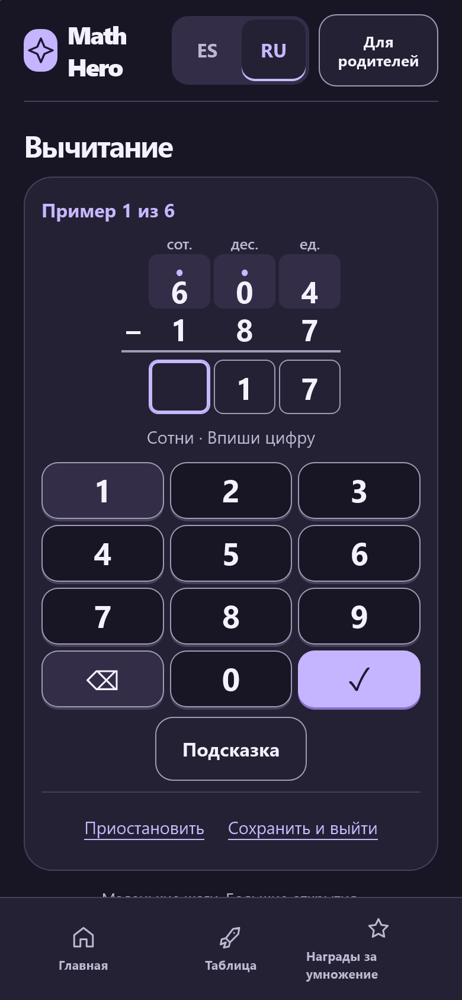
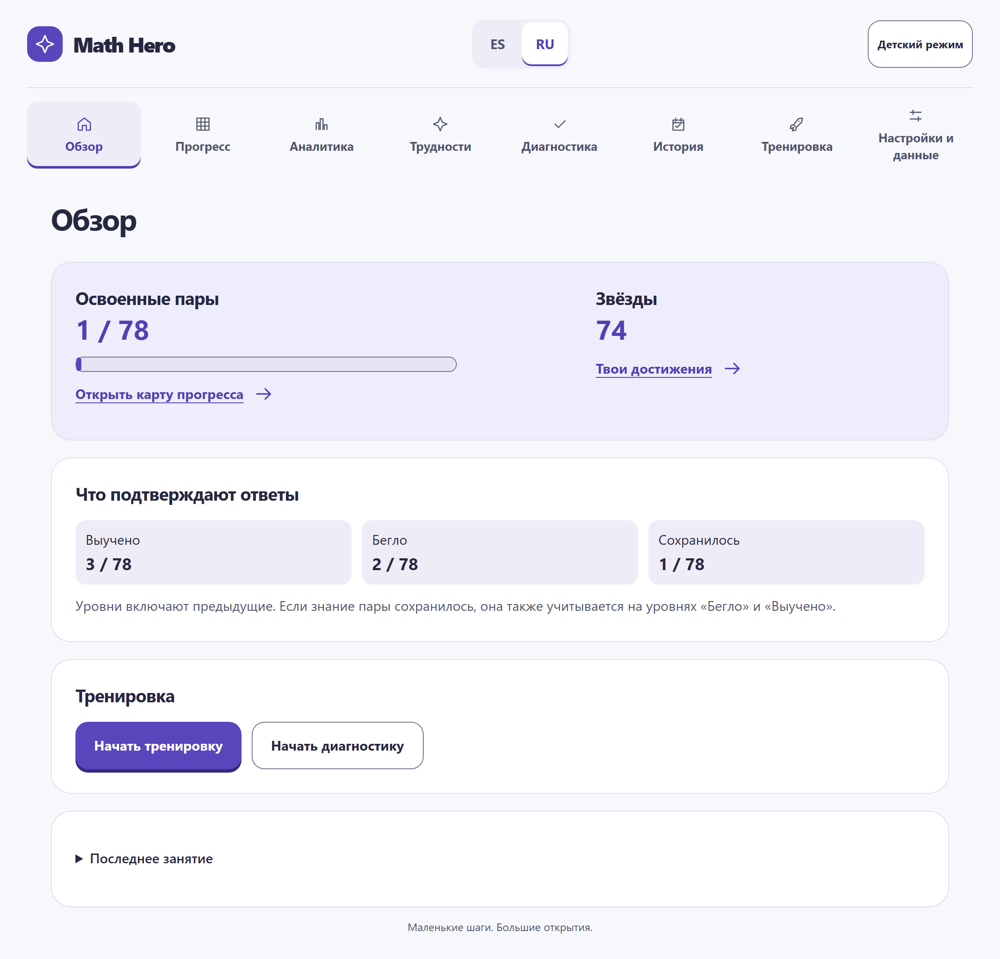

# MathHero

MathHero helps children practice multiplication facts for factors 1–12 and
three-digit addition and subtraction in columns. [Open the live app](https://dmitrygaravsky.github.io/MathHero/).

- **Child mode** offers short adaptive sessions. In column practice, children
  can add their own carry ones and borrow dots. Saved sessions resume with
  the same question, answer and notes.
- **Parent mode** has a local PIN, multiplication diagnosis and a 12 × 12
  progress map. Column reports show accuracy, independent solutions and
  practice history separately for addition and subtraction.
- **Spanish and Russian** interfaces support system, light and dark themes.
  Install from Safari on iPhone or iPad. Practice offline after the first
  successful setup.

The React, TypeScript and Vite app stores history in local IndexedDB. It has
no backend, accounts, child identifiers or telemetry. Keep learning history
portable with [JSON backups](docs/user/DATA_AND_BACKUP.md).

## Screenshots

| Child home · light, Spanish | Child practice · dark, Spanish |
| --- | --- |
|  |  |

| Column addition · light, Spanish | Column subtraction · dark, Russian |
| --- | --- |
|  |  |

The [column help example](docs/user/CHILD_GUIDE.md#column-arithmetic) shows
how a child can review a borrow through zero after an incorrect check. The
[parent guide](docs/user/PARENT_GUIDE.md#column-arithmetic) shows the addition
summary and an expanded history entry.

**Multiplication overview · light, Russian**. The counters come from a
synthetic backup fixture imported into the app.



**Parent map · dark, Spanish**. The selected square shows a 14-day recall check
from the same synthetic history.


## Quick start

With Node.js 24.15 or later in the 24 series:

```powershell
npm ci
npm run dev
```

Open [localhost on the MathHero base path](http://127.0.0.1:5173/MathHero/).

## Documentation and release status

Version 1.2.0 is published and adds column arithmetic. Automated and live
offline checks passed; physical iPhone/iPad acceptance of 1.2 remains pending.
The delivery record contains verification and publication evidence.

- [Child guide](docs/user/CHILD_GUIDE.md) · [Parent guide](docs/user/PARENT_GUIDE.md) · [Settings and offline use](docs/user/SETTINGS.md)
- [Learning model](docs/pedagogy/LEARNING_MODEL.md) · [Architecture](docs/architecture/OVERVIEW.md) · [Testing](docs/development/TESTING.md)
- [Documentation index](docs/README.md) · [1.2 delivery record](docs/DELIVERY-COLUMN-ARITHMETIC.md) · [1.2 physical-device checklist](docs/DEVICE-ACCEPTANCE-1.2.md)

MathHero is available under the [MIT License](LICENSE).
