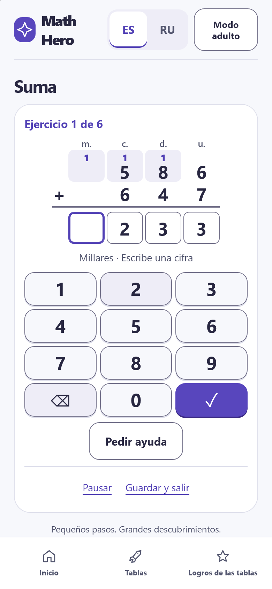

# MathHero

Offline-first math practice for kids: multiplication tables and three-digit
addition and subtraction in columns. Short adaptive sessions, optional working
notes and separate parent reports help families follow practice over time.

**[Open MathHero](https://dmitrygaravsky.github.io/MathHero/)** ·
[What's new in 1.2](CHANGELOG.md#120--2026-11-17) ·
[Install or update on iPhone](docs/user/SETTINGS.md#install-and-practice-offline)

## Start practicing

1. Open the app online. No account or setup questionnaire is required.
2. Choose **Multiplication tables**, then Start; or **Column arithmetic**,
   then Addition or Subtraction. Each operation resumes its own saved practice.
3. Use the on-screen keypad. Pause or Save and exit to continue later.

The interface is available in Spanish and Russian, with system, light and
dark themes. Install from Safari with **Share → Add to Home Screen** and
check offline readiness in the installation you will use. See the
[installation and update guide](docs/user/SETTINGS.md), including
[updating the Home Screen app](docs/user/SETTINGS.md#apply-an-update).

Parent mode uses the default local PIN **1234**. History stays on the device;
there are no accounts, child identifiers, telemetry or cloud synchronization.
Use [JSON backups](docs/user/DATA_AND_BACKUP.md) to keep or transfer history.

## Two practice modules

| | Multiplication tables | Column arithmetic |
| --- | --- | --- |
| Exercises | Factors 1–12 | Two three-digit operands; addition and nonnegative subtraction |
| Regular session | 24 questions | 6 examples per operation |
| Answer entry | One product field | Digits from units leftward, with optional carry ones and borrow dots |
| Parent view | Diagnosis, 12 × 12 map, accuracy, fluency and recall | Separate addition/subtraction reports, first-check accuracy, independence, help and history |
| Progress | Multiplication mastery, stars and achievements | Skill evidence and reviews after a gap; separate from multiplication rewards |

Both modules give feedback, revisit difficulties, save unfinished practice
and work offline after setup. Read the [multiplication learning model](docs/pedagogy/LEARNING_MODEL.md)
or the [column arithmetic learning model](docs/pedagogy/COLUMN_ARITHMETIC.md).

| Multiplication · dark, Spanish | Column addition · light, Spanish |
| --- | --- |
|  |  |

See more examples in the [child guide](docs/user/CHILD_GUIDE.md) and
[parent guide](docs/user/PARENT_GUIDE.md).

## Documentation and release status

Version 1.2.0 is published. Automated and live offline checks passed;
[physical iPhone/iPad acceptance](docs/DEVICE-ACCEPTANCE-1.2.md) remains pending.

- [Release notes](CHANGELOG.md) · [Delivery evidence](docs/DELIVERY-COLUMN-ARITHMETIC.md)
- [Child guide](docs/user/CHILD_GUIDE.md) · [Parent guide](docs/user/PARENT_GUIDE.md) · [Settings and offline use](docs/user/SETTINGS.md)
- [Documentation index](docs/README.md) · [Architecture](docs/architecture/OVERVIEW.md) · [Testing](docs/development/TESTING.md)

## Run locally

The app uses React, TypeScript, Vite and IndexedDB. With Node.js 24.15 or later
in the 24 series, run these commands from the repository root:

```powershell
npm ci
npm run dev
```

Open [the local app](http://127.0.0.1:5173/MathHero/). See
[developer setup](docs/development/SETUP.md) and
[contributing](docs/development/CONTRIBUTING.md) for the complete workflow.

MathHero is available under the [MIT License](LICENSE).
