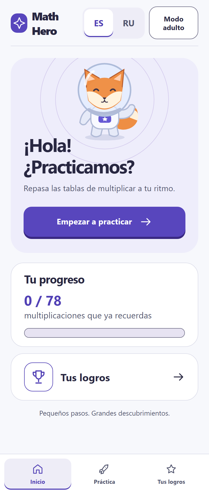
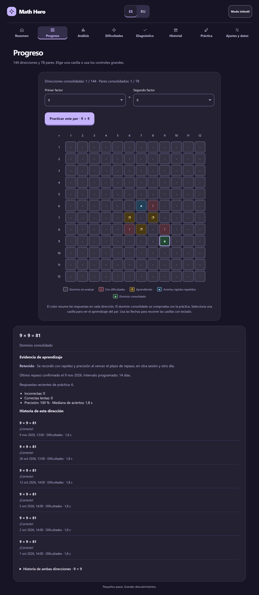

# MathHero

MathHero helps children practice multiplication for factors 1–12 and build
accurate, fluent recall. [Open the live app](https://dmitrygaravsky.github.io/MathHero/).

- **Child mode** opens to short adaptive practice, immediate feedback and
  achievements. Saved sessions can resume from the same question.
- **Parent mode** adds a local PIN, optional diagnosis, the 12 × 12 map,
  learning evidence, targeted practice, history, settings and backups.
- **Spanish and Russian** interfaces support system, light and dark themes.
  Install from Safari on iPhone or iPad. Practice offline after the first
  successful setup.

The React, TypeScript and Vite app stores history in local IndexedDB. It has
no backend, accounts, child identifiers or telemetry. Keep learning history
portable with [JSON backups](docs/user/DATA_AND_BACKUP.md).

## Screenshots

| Child home · light, Spanish | Child practice · dark, Spanish |
| --- | --- |
|  |  |

**Parent overview · light, Russian**. The counters come from synthetic practice
history imported into the app.


**Parent map · dark, Spanish**. The selected square shows a 14-day recall check
from the same synthetic history.



## Quick start

With Node.js 24.15 or later in the 24 series:

```powershell
npm ci
npm run dev
```

Open [localhost on the MathHero base path](http://127.0.0.1:5173/MathHero/).

## Documentation and release status

This branch prepares MathHero 1.1. The delivery record tracks verification
and publication.

- [Child guide](docs/user/CHILD_GUIDE.md) · [Parent guide](docs/user/PARENT_GUIDE.md) · [Settings and offline use](docs/user/SETTINGS.md)
- [Learning model](docs/pedagogy/LEARNING_MODEL.md) · [Architecture](docs/architecture/OVERVIEW.md) · [Testing](docs/development/TESTING.md)
- [Documentation index](docs/README.md) · [1.1 delivery status](docs/DELIVERY-1.1.md) · [Physical-device acceptance](docs/DEVICE-ACCEPTANCE.md)

MathHero is available under the [MIT License](LICENSE).
