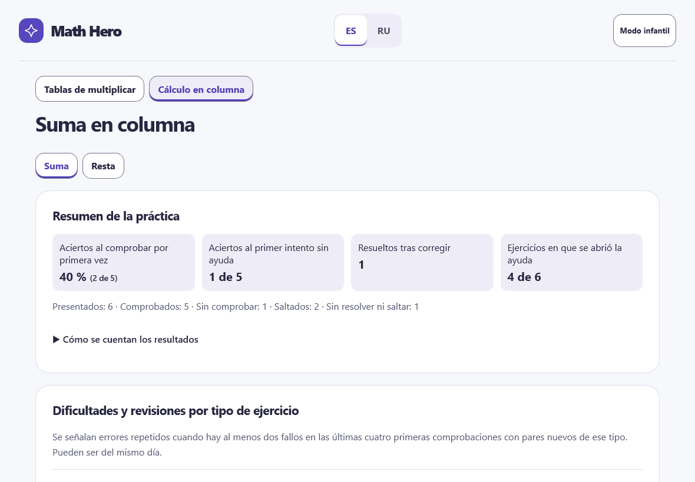
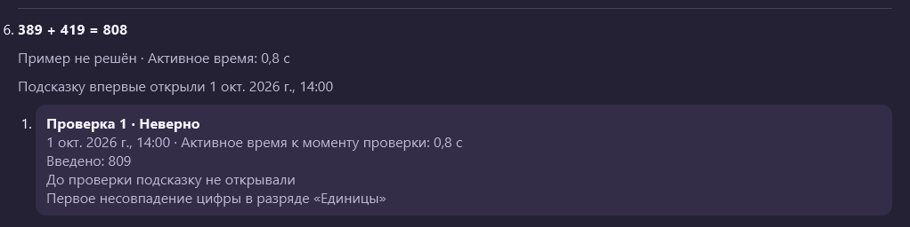

# Parent guide

Choose Parent mode and enter the four-digit PIN. The default is **1234**.
Use **Return to child mode** to go back in one action. A saved child practice
keeps its place, and an active question needs explicit resume.

Use the module selector to open **Multiplication tables** or **Column
arithmetic**. Settings and Data is available from the parent menu in the
multiplication view and applies to the whole app.

## Multiplication

| Destination | What you can do |
| --- | --- |
| Overview | See current mastery, stars, Learned/Fluent/Retained counts, the latest practice and achievements. The three knowledge counts overlap. |
| Progress map | Select a direction in the 12 × 12 table to read the legend, its answer history and the pair's shared evidence. Start targeted practice from the detail. |
| Analytics | Read accuracy, speed of correct answers, trends and changes in performance. |
| Weak Spots | Compare recent wrong and correct-but-slow answers, expand a pair's evidence, then start general weak practice or target that pair. Treat possible input slips as hypotheses. |
| Diagnosis | Start or resume the optional baseline, or open its results. The full baseline visits all 144 directions over six parts. |
| History | Filter practice and diagnostic sessions, expand a session and inspect recorded answers. |
| Practice | Start a new daily session or resume a saved one. |
| Settings and Data | Change preferences or PIN, manage backups, check offline readiness and open the bilingual glossary. |

On a narrow display, use the parent menu for these destinations. See
[how to read the evidence](../pedagogy/LEARNING_MODEL.md) and
[settings, PIN reset and offline use](SETTINGS.md).

## Column arithmetic

Choose Addition or Subtraction. The report shows evidence and history for the
selected operation. The first-check percentage uses the number of examples
checked at least once. The summary separately counts independent first-check
solutions, solutions after correction and examples with help opened. It also
shows how many examples were presented, unchecked, skipped or left unsolved
without a skip.

Expand a type of exercise to read its recent first-check errors and current
review evidence. A review after a gap shows its supporting dates, earlier
practice date and elapsed gap. Expand the timing section to find the sample
size and median active time for each comparable pattern.

Filter session history by status and open a session to see its examples,
checks, help, recorded notes and active time. The history includes unfinished
examples and preserves earlier successful reviews if a later first check
clears the current evidence. See the [column practice and evidence guide](../pedagogy/COLUMN_ARITHMETIC.md)
for how to interpret the counts.

These screenshots show an addition summary in Spanish and an expanded check
from the same replay-valid synthetic backup fixture in Russian. The dates
and results are test examples.

